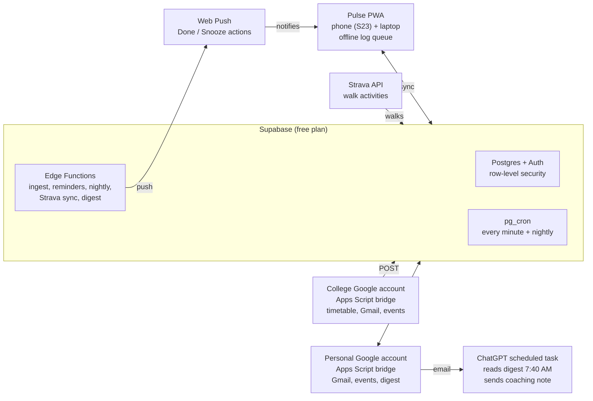

# Pulse — Personal Productivity Tracker PRD (v1)

Version 1.1 · Nov 26, 2026 · Owner: Lohit Deva · Single source of truth for the build (see AGENTS.md)

## 1. Overview

**TL;DR:** Pulse is a personal, phone-first web app (PWA) for one user, Lohit. It turns his ideal day into a live schedule, reminds him at the right moments, and records what actually happened. It covers tasks, classes, meals, fitness, study, reading, sleep, water, mood, spending and smoking. One day score, a heatmap and a missed-items log show progress over time. v1 costs ₹0 a month to run and is built by an AI coding agent working from this document.

**Problem.** Lohit is a term-2 MBA student at IIM Sambalpur with ADHD, and his days have no structure. He wakes late, skips breakfast, lunch and sometimes hygiene, and loses track of deadlines. Evenings go to gaming and smoking, and he sleeps very late. He rarely writes tasks down, and when he does (on a whiteboard) the list goes stale. He also takes on more than he can finish.

**Why now.** A recent slump led to missed classes, a poor quiz result and missed placement opportunities. He has decided to turn things around and wants a tool that gives every day a fixed structure.

**Why existing apps fail him.** Each app he has tried covers one slice: tasks, habits or food. None tracks everything in one place, so none stuck.

## 2. Goals, non-goals and success metrics

v1 succeeds if, within 8 weeks, Lohit runs every day from Pulse and never misses a meal, workout, class or deadline without logging a reason.

**Goals**

1. Give every day a fixed, visible structure: a daily template plus the live class timetable.
2. Make the must-dos impossible to forget: meals, gym, bedtime, classes and deadlines.
3. Show at a glance what is done, what is left and what is due.
4. Build the habits he wants (reading, study, walking, water) and cut the ones he doesn't (eating out, smoking to zero).
5. Support fat loss and strength: about 92 kg now, 80 kg target.
6. Keep logging under 2 minutes per check-in.

**Non-goals for v1**

- More than one user, sign-up flows or sharing
- A native Android app, Samsung Health or Health Connect data
- Automatic UPI or bank parsing (spending is typed in by hand)
- Calorie or macro counting
- Paid AI APIs or any paid service

**Success metrics** (baselines come from the first 7 days of use)

| Metric | Target by week 8 |
| --- | --- |
| Days with all 4 meals logged on time | 6 of 7 days |
| Workout (lifting or recovery) completed | 6 of 7 days |
| Classes attended (medical excused) | 100% |
| Deadlines submitted on time | 100% |
| Nights with 6 h+ sleep, lights out by 1:00 AM | 6 of 7 nights |
| Check-ins completed | 85% or more |
| 7-day average day score | 70 or more |
| Weight, 7-day average | Falling about 0.5 kg a week |
| Smoking, both habits combined | 0 a day, per the taper plan |
| Eating-out spend | Half of the week 1–2 baseline |
| Time estimates (median actual ÷ estimate) | Within 20% |

## 3. User and design principles

There is one user, and every design choice serves how his attention works: external structure, low friction, and nagging only where it matters.

**The user.** Lohit Deva, MBA 2026–28, Section C, IIM Sambalpur. He lives on campus and eats at the college mess. He uses a Samsung Galaxy S23 Ultra (Android, no smartwatch) and a laptop. He has two Google accounts (college and personal) and records walks on Strava.

**Design principles**

1. **Tell me what to do now.** The home screen leads with a "Now / Next" card: the current block, time left, and the next block. Lists come second.
2. **Logging takes seconds.** One-tap logging, "Done" and "Snooze" buttons on notifications, three short check-ins a day, and a quick-log command bar.
3. **Persistent for must-dos, quiet for the rest.** Meals, gym, bedtime, classes and deadlines keep reminding until they are resolved. Everything else gets one nudge. Nothing fires during class.
4. **Plan days that can actually be finished.** Every task gets a time block and an estimate. Pulse learns how far off his estimates run and warns when a day is overbooked.
5. **Bad days are data, not failure.** A missed item asks for a one-tap reason. Patterns get surfaced, there is no streak shaming, and medically excused items don't count against him.
6. **One place, one score.** Every area feeds one day score with a plain explanation of what pulled it up or down.
7. **Private by default.** Sensitive areas (smoking, mood, weight) use neutral labels and are left out of exports unless he opts in.

## 4. Daily structure

Each day is built from an editable template, overlaid with that day's Section C classes from the live timetable. Free slots between classes are filled with reading, study and tasks.

**Default weekday template** (all times IST; everything is editable in Settings)

| Time | Block | Type |
| --- | --- | --- |
| 7:00 AM | Wake up (his own alarms; no app reminder) | Anchor |
| 7:00–7:30 | Brush and freshen up | Habit checklist |
| 7:30–8:00 | Walk (auto-logged from Strava) | Habit |
| 8:00–8:45 | Shower and get ready (ready by 8:45 at the latest) | Habit checklist |
| \~8:40 | Morning check-in: sleep, mood, today's plan | Check-in |
| 8:45–9:20 | Breakfast at the mess, reading Inshorts (and Mint or WSJ if there's time) while eating | Must-do + habit |
| After breakfast | Any news minutes still left (Inshorts 15, Mint 30, WSJ 30 in total), placed in the earliest free slots and split if needed | Habit |
| 9:30–5:15 | Classes from the timetable; free slots get study, reading or tasks | Must-do |
| 1:00 PM | Lunch (mess 1:00–3:00; class break 12:45–2:00) | Must-do |
| \~1:40 PM | Midday check-in: meals so far, water, mood | Check-in |
| 5:30 PM | Snacks (mess 5:30–6:30) | Must-do |
| 6:00 PM | Revision: 15 min for each subject held that day | Habit (nudge) |
| after revision–7:30 | Study block 1 | Habit (nudge) |
| 7:30–8:45 PM | Gym: weigh-in, today's workout, cardio and abs (gym open 7:30–10:00 PM) | Must-do |
| 8:45–9:00 PM | Freshen up after the gym | Buffer |
| 9:00–9:30 PM | Dinner (mess 8:00–10:30) | Must-do |
| 9:30–10:30 PM | Study block 2: suggested subject or priority task | Habit (nudge) |
| 10:30 PM–12:30 AM | Personal call | Fixed block |
| 12:30–1:00 AM | Wind-down: night check-in, then book reading | Check-in + habit |
| 1:00 AM | Lights out (6 h sleep target) | Must-do |

Blocks can overlap: reading during breakfast counts toward the news minutes. On a day with three classes, the two study blocks give about 1 h 45 min of deep study (45 + 60 min), and free slots between classes add more. A **weekend template** keeps the same anchors (meals, gym, bedtime) with shorter study blocks. Classes still come from the sheet.

**Facility hours** (in Settings; they set reminder windows):

- **Mess:** breakfast 8:30–10:30 AM, lunch 1:00–3:00 PM, snacks 5:30–6:30 PM, dinner 8:00–10:30 PM.
- **Gym:** 7:30 AM–2:30 PM and 7:30–10:00 PM.

**Day boundary.** A Pulse day runs from 4:00 AM to 3:59 AM IST, so the 12:30 AM check-in and the 1:00 AM bedtime count toward the day that just ended.

**Live timetable sync**

- **Source.** Google Sheet "2026-28\_ MBA\_Term II Schedule", tab "Schedule". It is view-only and readable only by his college Google account. The term is filled in, but faculty can change any slot at any time.
- **Layout.** Row 3 is the header: Date, Day, Sections, then five slot columns: 9:30–11:00, 11:15–12:45, Lunch 12:45–2:00, 2:00–3:30, 3:45–5:15. Each date takes four rows (Sections A–D), with Date and Day merged down them. Pulse reads only the Section C row.
- **Cells.** Usually `COURSE-SESSION (Prof. Name)`, sometimes with a room, e.g. `MM-II-1 (Prof. Atul Prashar)` or `OM-I - 2 ( Prof. Rohit Gupta ) ( B04)`. Spacing and brackets vary (`DS - II-1 Prof. Sourabh Kumar` has none), so the parser normalises spaces and hyphens and keeps the raw text as the title when the pattern fails (e.g. "Industry Talk").
- **Merged cells.** A cell spanning all section rows (e.g. Term Registration) applies to Section C too. A cell spanning several slots covers all of them. Times written inside a cell ("10:30 - 01:00") override the slot times.
- **Dates.** "28-Sep" style. The year is inferred from the term: Sep–Dec is 2026, Jan onward is 2027.
- **Course codes seen so far:** MM-II, OM-I, OB-II, FM-I, DS-II. Full course names are editable in Settings.
- **Exams.** Cells that mention an exam ("Exam", "Mid-term", "End-term") become Exam items for that course and date, which feed the deadlines list and study suggestions. Quizzes arrive by email through the Review inbox, or he adds them by hand.
- **Sync schedule.** Daily at 5:30 AM, whenever the app opens and the last sync is over 12 hours old, and on a manual Refresh button.
- **Change alerts.** Each sync is compared with the last snapshot. Any added, removed, moved or restored class sends one notification (e.g. "OM-I-2 moved to 2:00 PM today") and is listed on the Today screen.
- **Class handling.** A reminder 10 minutes before each class, then an attendance prompt when it ends: Attended / Missed / Medical / Cancelled. Class time is quiet time for every other notification.
- **Cancelled classes can be added back.** A cancelled class stays on the timeline, struck through, with a **Restore** button that brings it back with its reminders.
  - Removed from the sheet: if a later sync lists the class again, Pulse restores it automatically and sends an alert ("OM-I-2 is back on at 2:00 PM").
  - Cancelled by hand while the sheet still lists it: it stays cancelled until he taps Restore, or until that cell changes in the sheet. The sheet then wins, with an alert.
- **Manual changes.** He can also mark a class moved, or add an extra class the sheet doesn't show. A sync never silently undoes a manual change.

## 5. Tasks and deadlines

Every piece of work is an item with a type, a time block and an estimate. Pulse always shows what is due next and whether today fits in the hours available.

**Item types**

| Type | Example | Repeats | How it's completed |
| --- | --- | --- | --- |
| Task | Submit OM forecasting report, due Fri 11:59 PM | No | Mark done; log actual time |
| Daily habit | Breakfast, brush, 2 bottles of water | Every day | Tap, counter or auto-log |
| Recurring item | Call extended family | Weekly or custom (default Sunday) | Tap |
| Yearly date | Birthdays, festivals | Yearly; reminder 2 days before and on the day | Tap "wished" |
| Class | MM-II-3 | From the timetable | Attendance prompt |
| Fixed block | Personal call, sleep | From the template | No logging needed |

**Task fields:** title, category (Course / Live project / Placement / Personal), linked course, priority (P1–P3), deadline (date and time), estimate in minutes, scheduled block, status (To do, Scheduled, In progress, Done, Missed, Dropped), actual start and end, source (Manual / Gmail / Calendar), notes.

**Where deadlines come from**

- **Manual.** Quick add takes title, deadline and estimate. "Plan it" suggests the earliest free slot before the deadline that fits the estimate times his learned multiplier.
- **Gmail (both accounts).** A daily scan of the last 48 hours looks for deadline words (deadline, due, submit, submission, quiz, assignment, exam, last date, apply by, registration closes). It pulls out a likely date and time with a date parser. Each match goes to a **Review inbox** with the sender, a snippet and a link to the email. Nothing becomes a task until he taps Confirm (editable) or Dismiss.
- **Google Calendar (both accounts).** Events for the next 14 days appear on the timeline as fixed blocks. Events with deadline words also go to the Review inbox. Calendar birthdays can seed the yearly dates. All Google access is read-only.

**Protection against overcommitting**

- Each day has a capacity: the free minutes left after classes, meals, gym, the call and sleep.
- When planned task minutes (estimates times his multiplier) exceed capacity, the Today screen warns, e.g. "Overbooked by 1 h 20 min". It suggests moving the lowest-priority task with the latest deadline.
- Quick add warns when a new task won't fit before its deadline.

**Learning from estimates**

- When a task is marked done, he confirms actual start and end. These are prefilled from the focus timer if he used it, otherwise from the scheduled block.
- Pulse stores actual ÷ estimate and keeps a rolling median of the last 20 tasks per category.
- It shows the result ("Assignments take you 1.4× your estimate") and pre-stretches new blocks by that factor. He can accept or override.

**Due and left views**

- **Deadlines list:** sorted by due time with countdown chips (red under 24 h, amber under 72 h).
- **Today strip:** tasks done vs planned, minutes left, next deadline.

**Deadline reminders (must-do):** in the morning digest 3 days before, then 24 h, 3 h and 1 h before. After that they repeat until the task is marked done, or it is past due and logged as missed.

## 6. Reminders and check-ins

Must-dos keep reminding him until he resolves them, everything else gets one nudge, and nothing fires during class or sleep.

**Reminder levels**

| Level | Items | Behaviour |
| --- | --- | --- |
| Must-do | Breakfast 8:45 AM, lunch 1:00 PM, snacks 5:30 PM, dinner 9:00 PM, gym 7:30 PM, bedtime 1:00 AM, classes (10 min before), deadlines | Repeats every 10 min (configurable 5–30) until Done, Snooze, Skip with reason, or Medical |
| Nudge | Revision, study blocks, news and book reading, family call, birthdays | One notification at block start |
| Pace nudge | Water | 11 AM, 3 PM and 7 PM, only if behind pace for 2 bottles |
| None | Wake-up, walk, hygiene checklist | No notification; logged at the morning check-in |

**How a must-do resolves**

- Each must-do has a window set by facility hours: mess hours for meals, gym hours (7:30–10:00 PM) for the workout. A meal window also closes 10 minutes before the next class, so breakfast must be done by 9:20 on days with a 9:30 class.
- After 3 ignored repeats, the wording gets firmer and the item turns red on the home screen.
- If the window closes unresolved, the item is logged as **Missed** and goes to the missed log. The next check-in asks for a one-tap reason.
- Bedtime is special. A "wind down" nudge fires at 12:45 AM, then reminders at 1:00 AM every 10 min until "Going to sleep" is tapped, up to 2:00 AM.

**What counts as done (verification within PWA limits)**

| Item | Evidence |
| --- | --- |
| Gym | A saved workout with at least one logged set, or a completed recovery session |
| Walk | A Strava activity of type Walk that day; manual entry as fallback |
| Meals | Tap with time; what he ate is optional |
| Class | The attendance prompt answered |
| Bedtime | "Going to sleep" tapped; wake time confirmed next morning |
| Deadline | Marked submitted |
| Water | Counter reaches 2 bottles |

**Notification actions:** Done and Snooze 10 min, plus Skip where the platform allows. Tapping a notification opens the item already focused.

**Quiet rules**

- No notification during a Section C class slot. Anything due then is held until the class ends.
- Nothing between 2:00 AM and 7:00 AM.
- Must-do deadline reminders can still fire during the personal call. Nudges cannot.

**Morning digest (one notification at 8:40, which opens the morning check-in):** today's classes and any timetable changes, deadlines in the next 3 days, today's workout and yesterday's score.

**Check-ins** (one screen each, every field skippable, under 2 minutes)

1. **Morning (\~8:40 AM):** bedtime and wake time, mood, hygiene checklist, today's plan with any overbooking warning.
2. **Midday (\~1:40 PM):** meals so far, water, mood, quick adds.
3. **Night (12:30 AM):** 3-prompt reflection, spending, smoking counts, gaming minutes, water, mood. It also lists anything still unlogged, so each item gets marked done or missed with a reason.

## 7. Fitness module

Pulse prescribes a workout for every day. Six days of full-body circuits come first, then a repeating upper/lower split with light recovery days in between. Every session includes cardio and abs, and weights rise by fixed rules. No AI is needed. If he has a health condition or old injury, he should check with a doctor before starting.

**Program phases**

| Phase | When | Day-by-day |
| --- | --- | --- |
| 1. Re-entry | Days 1–6 | Circuit A, Recovery, Circuit B, Recovery, Circuit A, Recovery |
| 2. Upper/lower | Day 7 onward, 7-day cycle | Upper A, Lower A, Recovery, Upper B, Lower B, Recovery, Recovery |

**Circuits (phase 1):** 3 rounds of the list, 60–90 s rest between rounds, at an easy-to-moderate effort. The finisher comes after the last round.

| Circuit A | Reps | Alternatives |
| --- | --- | --- |
| Goblet squat | 12 | Bodyweight squat, leg press, box squat |
| Push-up | 8–12 | Incline push-up, knee push-up, machine chest press |
| One-arm dumbbell row | 10 per side | Seated cable row, inverted row, machine row |
| Dumbbell Romanian deadlift | 10 | Kettlebell deadlift, back extension, cable pull-through |
| Plank | 30 s | Knee plank, dead bug, bird dog |
| Finisher: bike or rower intervals | 10 min (30 s hard, 60 s easy) | Incline walk, jump rope, elliptical |

| Circuit B | Reps | Alternatives |
| --- | --- | --- |
| Dumbbell reverse lunge | 8 per side | Split squat, step-up, leg press |
| Dumbbell bench press | 10 | Push-up, machine chest press, cable press |
| Lat pulldown | 10–12 | Assisted pull-up, band pulldown, straight-arm pulldown |
| Glute bridge | 12–15 | Light hip thrust, single-leg bridge, cable pull-through |
| Dead bug | 10 per side | Hollow hold, bird dog, crunch |
| Finisher: incline walk | 10 min | Bike, elliptical, stair climber |

**Upper/lower sessions (phase 2)**

| Upper A | Sets × reps | Alternatives |
| --- | --- | --- |
| Barbell bench press | 3 × 6–8 | Dumbbell bench press, machine chest press, weighted push-up |
| Barbell row | 3 × 8–10 | Chest-supported dumbbell row, seated cable row, machine row |
| Standing overhead press | 3 × 8–10 | Seated dumbbell press, machine shoulder press, landmine press |
| Lat pulldown | 3 × 10–12 | Assisted pull-up, single-arm cable pulldown, band pulldown |
| Lateral raise | 2 × 12–15 | Cable lateral raise, machine lateral raise, light upright row |
| Triceps pushdown | 2 × 12 | Overhead dumbbell extension, close-grip push-up, assisted dip |
| Abs: hanging knee raise | 3 × 10–15 | Captain's chair raise, lying leg raise, reverse crunch |
| Cardio: intervals on bike or rower | 15 min (30 s hard, 90 s easy) | Incline walk, elliptical, jump rope |

| Lower A | Sets × reps | Alternatives |
| --- | --- | --- |
| Back squat | 3 × 5–8 | Goblet squat, leg press, hack or Smith squat |
| Romanian deadlift | 3 × 8–10 | Dumbbell RDL, good morning, 45° back extension |
| Leg press | 3 × 10–12 | Hack squat, Bulgarian split squat, step-up |
| Leg curl (lying or seated) | 2 × 12 | Swiss-ball curl, dumbbell leg curl, assisted Nordic curl |
| Standing calf raise | 3 × 12–15 | Seated calf raise, leg-press calf raise, single-leg calf raise |
| Abs: cable crunch | 3 × 12–15 | Weighted crunch, ab wheel, decline crunch |
| Cardio: incline walk | 15 min | Bike, stair climber, elliptical |

| Upper B | Sets × reps | Alternatives |
| --- | --- | --- |
| Incline dumbbell press | 3 × 8–10 | Incline barbell press, machine incline press, feet-elevated push-up |
| Pull-up (assisted is fine) | 3 × 6–10 | Lat pulldown, band-assisted pull-up, inverted row |
| Seated cable row | 3 × 10–12 | One-arm dumbbell row, machine row, T-bar row |
| Seated dumbbell shoulder press | 3 × 10 | Machine shoulder press, Arnold press, landmine press |
| Face pull | 2 × 15 | Band pull-apart, rear-delt fly, reverse pec deck |
| Dumbbell curl | 2 × 12 | Cable curl, hammer curl, EZ-bar curl |
| Abs: plank | 3 × 45 s | Side plank, ab-wheel rollout, hollow hold |
| Cardio: intervals on bike or rower | 15 min | Incline walk, elliptical, jump rope |

| Lower B | Sets × reps | Alternatives |
| --- | --- | --- |
| Deadlift (conventional or trap bar) | 3 × 5 | Trap-bar deadlift, rack pull, dumbbell deadlift |
| Bulgarian split squat | 3 × 8–10 per side | Reverse lunge, split squat, step-up |
| Hip thrust | 3 × 10 | Glute bridge, single-leg hip thrust, cable pull-through |
| Leg extension | 2 × 12–15 | Spanish squat, assisted sissy squat, cyclist squat |
| Abs: hanging leg raise | 3 × 10 | Lying leg raise, captain's chair raise, reverse crunch |
| Abs: Pallof press | 2 × 12 per side | Side plank, cable woodchop, suitcase carry |
| Cardio: incline walk | 15 min | Bike, stair climber, elliptical |

**Recovery day (30–45 min):** 25–35 min of easy cardio at a pace where he can still talk (incline walk, bike or elliptical), 10 min of mobility, and 2 rounds of an abs circuit (dead bug, side plank, reverse crunch). It counts as the day's workout.

**Progression rules**

- **First time on an exercise:** he logs a weight that leaves 2–3 reps in the tank. That becomes the starting load.
- **Double progression:** when every working set reaches the top of the rep range, the next session adds load. That's +2.5 kg on upper-body barbell lifts, +5 kg on lower-body barbell lifts, the next dumbbell step (about +2 kg per hand) on dumbbells, and one stack step on machines. Otherwise the load stays and he aims for one more rep.
- **Stalls:** below the bottom of the range in 2 sessions in a row means 10% less load.
- **Deload:** every 6th week of phase 2 drops one set per exercise and takes 10% off the load.
- **Cardio:** intervals start at 6 rounds and add 1 a week, up to 10. Easy cardio adds 5 min a week, up to 40.
- **Abs:** +2 reps or +10 s a week until the top of the range, then a harder variation.

**Missed days**

- Sessions are a queue, not fixed weekdays. A missed lifting session moves to the next day rather than being skipped. A recovery day can be swapped for it, with no more than 3 lifting days in a row.
- After 3–6 days off, the first session back runs at 90% load. After 7–13 days, 80%. After 14+ days, 3 re-entry circuits come before the split resumes.
- If the evening session is missed, the next day offers a make-up in a free gap during the gym's morning hours (7:30 AM–2:30 PM). Every missed workout appears in the missed log with its reason.

**Swapping an exercise:** a Swap button on every exercise shows its alternatives. He picks one and a reason: No equipment, Machine busy, Bad form, Pain or Preference. The alternative keeps its own progression history. If he picks "Pain" twice on the same exercise, Pulse suggests replacing it permanently and getting it checked.

**Logging screen**

- Per set: weight, reps, and an optional reps-in-reserve tap (0, 1, 2, 3+).
- Last session's numbers show as faded placeholder text, with a "Copy last" button.
- A rest timer starts on its own: 90 s after compound lifts, 60 s after accessories.
- **Stats:** weekly sets per muscle group, personal records, estimated 1-rep max trend for squat, bench, deadlift and overhead press (Epley formula), and a workout heatmap.

**Body weight**

- A daily weigh-in at the gym, logged on the workout screen before the first set. Same time and same scale each day keeps readings comparable.
- The chart shows daily dots, a 7-day moving average line, the 80 kg target line and a projected date at the current rate.
- The default plan is 0.5 kg a week, with the target date set from the first weigh-in. From about 92 kg that is roughly 24 weeks.
- If the 7-day average falls faster than 1 kg a week for 2 weeks running, Pulse flags it as too fast.

## 8. Study and reading

The timetable drives the evening revision list. A focus timer records study time per course, and a simple ranking suggests what to study in each deep-study block.

**Evening revision (6:00 PM)**

- Pulse auto-builds a checklist of the sessions held that day, e.g. "Revise MM-II-3, OM-I-2, FM-I-2, 15 min each". Each line has its own timer.
- A class marked Missed or Medical becomes a 30-minute "Catch up on \<session>" task instead, due within 3 days.
- Revision completion % feeds the day score.

**Focus timer**

- It starts from any study block, task or revision line. Modes: 25/5 (default), 50/10, or open-ended.
- Every session is tagged with a course and/or task. Pause and resume are supported, and the screen can stay awake.
- Timer state lives on the server as start and pause timestamps, so it survives closing the app and shows on both phone and laptop.
- When it stops, the minutes are logged to the course and task. If the task is then marked done, they prefill its actual time.

**Study suggestions (rule-based, no AI)**

Each course gets a score from 0 to 100, and the top 2 show on study blocks with a one-line reason (e.g. "FM-I: quiz in 2 days, last studied 5 days ago"):

| Factor | Weight | How it's measured |
| --- | --- | --- |
| Deadline urgency | 40 | Nearest quiz, exam or assignment for the course within 7 days: (7 − days left) ÷ 7 |
| Staleness | 25 | Days since the last focus session on the course ÷ 7, capped at 1 |
| Upcoming classes | 20 | Sessions in the next 2 days ÷ 2, capped at 1 (pre-reading) |
| Catch-up | 15 | Unrevised missed sessions ÷ 2, capped at 1 |

A P1 task due within 48 hours always comes first in study block 2. Exams come from the timetable automatically (section 4). Quizzes arrive by email through the Review inbox, or he adds them as tasks of type "Quiz" with a course and a date.

**Reading**

| Item | Daily target | Logged as |
| --- | --- | --- |
| Inshorts | 15 min | Minutes (timer or typed) |
| Mint | 30 min | Minutes |
| WSJ | 30 min | Minutes |
| Book | 20 min at wind-down | Minutes, optional pages; current book title |

A finished-books list and weekly minutes per source appear on the Study and Reading screen. Study minutes per course per week appear there too.

## 9. Wellbeing: sleep, water, mood, smoking, gaming

These areas are logged in seconds at check-ins. Smoking runs on a taper plan to zero, and mood is watched for worrying patterns.

**Sleep**

- **Target:** 6 hours, lights out 1:00 AM, wake 7:00 AM, per Lohit's choice. It is one setting and easy to change.
- **Logging:** bedtime is prefilled from the "Going to sleep" tap, and wake time is confirmed at the morning check-in.
- **Display:** last night's hours, the 7-day average vs target, and a chart of sleep hours against the next day's score, so the effect of short nights is visible in his own data.

**Water**

- **Target:** 2 bottles (2 L) a day, excluding what he drinks at the gym.
- **Logging:** taps of +½ and +1 bottle. Gym water is logged separately and doesn't count.
- **Reminders:** pace nudges at 11 AM, 3 PM and 7 PM, only when behind.

**Mood and reflection**

- **Mood:** a 1–5 tap with faces at every check-in, an optional 1–5 energy tap, and optional tags (stressed, anxious, calm, tired, motivated, lonely). The day's mood is the average.
- **Night reflection, one line each:**
  1. What went well today?
  2. What didn't, and why?
  3. One thing to do differently tomorrow? This can be turned into a task with one tap.

**Mood pattern alerts (rule-based)**

An alert fires when any of these is true:

- The day's average mood is 2 or lower for 3 days in a row.
- The 7-day average is at least 1 point below the previous 28-day average.
- Mood is 2 or lower on 4 or more of the last 7 days.

The alert is one notification plus a card: "Your mood has been low for a few days. That's worth paying attention to. Consider talking to someone you trust or a counsellor." The card shows Tele-MANAS, India's free, 24×7 mental-health helpline: 14416 or 1-800-891-4416 ([source](https://pib.gov.in/PressReleasePage.aspx?PRID=2022057)). It fires at most once every 7 days and never uses diagnostic language.

**Smoking taper to zero**

- **Labels:** two counters, "Habit A" and "Habit B", which he can rename. His rough baseline is 3–4 a day of each.
- **Logging:** each tap records the time and an optional trigger tag (after class, after a meal, with friends, bored, stressed, during the call).
- **Week 1 is baseline only.** He logs with no limits, because his numbers are a guess.
- **From week 2 there are daily caps.** Each cap starts at that habit's week-1 daily average, rounded down. At the default pace, one cap drops by 1 each week, alternating between habits.
- **Pace:** a setting of gentle (a drop every 2 weeks), standard, or fast. At the standard pace, 3–4 a day of each reaches zero about 8 weeks after starting.
- **Home display:** e.g. "Habit A: 2 of 3 today". Going over the cap is logged honestly, with no lockout, and counts against the Health score.
- **Stats:** count per day, smoke-free days, and a time-of-day and trigger heatmap to show when urges hit.
- **Support:** after 3 days in a row over the cap, Pulse suggests a slower pace. It also shows support options: a doctor for either habit, and the National Tobacco Quit Line, 1800-112-356, toll-free ([source](https://ntcp.mohfw.gov.in/national_tobacco_quit_line_services)).

**Gaming (awareness only)**

- Logged with a start/stop timer or as minutes at the night check-in.
- He sees weekly hours and how they line up with his day score. There are no limits and no reminders.

**Privacy defaults:** smoking, mood and weight use neutral labels. They are left out of data exports unless he switches them on. Whether they go into the ChatGPT digest (section 12) is a toggle per area, on by default so the review is useful.

## 10. Spending

Spending is typed in by hand in a few taps. The goal is to see where money goes and halve eating-out spend by week 8 through a weekly cap that shrinks gradually.

**Entry (under 10 seconds)**

- **Fields:** amount in ₹, place (autocompletes from history), category, method (UPI by default, Cash, Card), optional note. The time defaults to now.
- **Categories:** Eating out, Mess/canteen extras, Groceries and snacks, Transport, Subscriptions, Academic, Personal care, Social, Other.
- **Ways in:** the command bar ("250 swiggy"), the + button, or the night check-in prompt "Anything spent today?".
- **Meal link:** a meal log can record where he ate (Mess / Outside / Ordered in). Outside and Ordered in count as eating-out meals, even before the spend is entered.

**Eating-out reduction**

- **Weeks 1–2 are baseline:** weekly eating-out spend and number of eating-out meals.
- **From week 3,** a weekly eating-out cap starts at 90% of baseline and drops by 10% of baseline every week until it reaches 50%. After that it holds, unless he lowers it further.
- **Home tile:** "₹X left this week" with a progress bar. Going over is allowed and logged, and it counts against the Habits score.

**Analysis (Money screen)**

- Top 10 places by spend, and spend by category, this week and this month
- Spend by day of week and time of day (e.g. late-night orders)
- Weekly trend line, with eating-out share of total spend
- Eating-out meals vs skipped mess meals, to show whether skipping the mess drives ordering in

## 11. Day score, heatmaps and the missed log

One transparent 0–100 score per day combines Tasks (35%), Habits (30%) and Health (35%). A missed-items log turns bad days into patterns he can act on.

**Day score.** Score = 0.35 × Tasks + 0.30 × Habits + 0.35 × Health. Each pillar is a weighted average of its components, each from 0 to 1. Components that don't apply that day (no classes, smoking baseline week) and items excused as Medical drop out, and the other weights are rescaled.

| Pillar | Component | Weight | Scoring |
| --- | --- | --- | --- |
| Tasks | Planned tasks done | 35 | Weighted by priority: P1 × 3, P2 × 2, P3 × 1 |
| Tasks | Deadlines due today met | 25 | 1 if all met on time; 0 if any missed |
| Tasks | Classes attended | 25 | Share attended |
| Tasks | Study | 15 | Half for revision done, half for deep-study minutes ÷ the day's planned minutes (capped at 1) |
| Habits | Meals | 35 | Per meal: on time 1, up to 60 min late 0.5, missed 0 |
| Habits | Reading | 20 | Minutes ÷ daily target, per source, averaged |
| Habits | Water | 15 | Bottles ÷ 2, capped at 1 |
| Habits | Morning routine | 10 | Share of the hygiene checklist done |
| Habits | Check-ins done | 10 | Share of 3 completed |
| Habits | Eating-out pace | 10 | 1 if week-to-date spend is within the weekly cap's pace |
| Health | Workout | 35 | 1 if the day's session (lifting or recovery) was logged |
| Health | Sleep | 30 | 1 at or above target, falling linearly to 0 at 3 h under; −0.2 if lights out after 1:30 AM |
| Health | Smoking | 20 | 1 if within both caps; −0.5 for each one over, floor 0 |
| Health | Walk | 10 | 1 if logged |
| Health | Weigh-in | 5 | 1 if logged |

Tapping the score opens the breakdown: each pillar, each component, and what cost points (e.g. "−10: lunch missed"). Gaming isn't scored.

**Heatmaps**

- **Calendar heatmap:** a GitHub-style grid of weeks × days, shaded by day score in four bands (0–39, 40–59, 60–79, 80–100). Tapping a day opens its breakdown.
- **Item heatmap:** rows are must-dos and habits, columns the last 30 days. Each cell is Done, Partial, Missed, Excused or Not scheduled, so a gap in one row stands out.

**Missed-items log**

- **What's recorded:** every missed item, with date, scheduled time, category and a one-tap reason. Reasons: Overslept, Forgot, No time or overbooked, Low energy, Social plans, Class ran over, Not hungry, Felt unwell, Other (with note).
- **Patterns (rolling 14 and 30 days):** most-missed items (count and % of scheduled), misses by weekday and by time of day, top reasons per item, and misses after nights under 5 hours of sleep, after 2+ hours of gaming, or on days over the smoking cap.
- **Each pattern becomes one plain sentence with a suggestion** from a rule library. Example: "Breakfast missed 5 of the last 7 days, 4 times because you overslept. Try moving the walk to after breakfast on class days."

**Insights panel (always visible; refreshed nightly, weekly summary on Sunday night)**

- Strongest and weakest pillar this week, and the biggest change from last week
- Up to 3 focus suggestions from the rule library, ranked by points lost
- Simple comparisons he can read at a glance, e.g. "After 6 h+ of sleep your score averages 74; after under 5 h, 58". The same comparison runs for gaming hours vs score and smoking count vs mood.

## 12. Quick logging and AI insights

v1 needs no paid AI. Workout adjustments, study suggestions and insights are rule-based (sections 7, 8, 11). Logging uses a short-command bar. A daily ChatGPT task reads an emailed digest and sends coaching back.

**Command bar (v1, rule-based)**

It's reachable from the home screen and a floating button. It autocompletes as he types and shows a preview of what will be saved; Enter confirms. Several commands can go in one line, separated by commas ("lunch, w 1, 120 canteen"). Unknown input offers the closest matches and never guesses silently.

| What | Type this | Saves |
| --- | --- | --- |
| Water | `w 1`, `w half` | +1 or +½ bottle |
| Meal | `lunch`, `dinner outside 180` | Meal now; with a place and amount, also an eating-out spend |
| Spend | `250 swiggy`, `40 auto` | ₹ amount and place; category guessed from history |
| Reading | `mint 20`, `book 25` | Minutes for that source |
| Smoking | `a+`, `b+` | +1 to Habit A or B |
| Gaming | `game 45` | 45 minutes |
| New task | `task OM report fri 6pm 90m p1` | Task with deadline, estimate and priority |
| Mark done | `done gym`, `done breakfast` | Marks the item done |
| Weight | `wt 91.8` | Weigh-in |
| Mood | `mood 3` | Mood tap |
| Sleep | `slept 1:10 7:05` | Bedtime and wake time |

**Free-form language (v1.1, optional, off by default).** A setting can send command-bar text to the Gemini API free tier to parse free sentences into the same commands. Google may use free-tier inputs to improve its products, so smoking, mood and weight text is never sent. Model IDs change often, so the model name lives in Settings.

**AI insights through ChatGPT (v1)**

1. At 1:15 AM Pulse builds a **daily digest** in plain Markdown, under 1,500 words. It contains:
   - yesterday's score and breakdown, and what was done and missed (with reasons)
   - 7-day trends per pillar, workouts with top sets, and study minutes per course
   - deadlines in the next 7 days, a spending summary, smoking vs caps (neutral labels)
   - mood and the reflection text, and the 7-day average weight
2. The digest leaves out Strava activity details, because Strava's API agreement bars using its data in AI models ([source](https://www.techradar.com/health-fitness/strava-could-soon-stop-working-with-some-of-your-third-party-apps-heres-what-you-need-to-know)). It only says whether the walk habit was done.
3. The personal Google account's Apps Script bridge (section 14) fetches the digest and emails it to his personal Gmail, with the subject "Pulse digest – YYYY-MM-DD".
4. A ChatGPT scheduled task runs daily at 7:40 AM IST. It reads the latest digest through ChatGPT's Gmail app and replies with coaching: 3 wins, 3 focus areas, workout and study tweaks, and a one-line plan for the day. ChatGPT's scheduled tasks can use connected apps ([source](https://help.openai.com/en/articles/10291617-tasks-in-chatgpt)). Setup steps are in the appendix.
5. A **Coach notes** box on the Today screen lets him paste ChatGPT's main takeaway so it stays in front of him. A **Copy digest** button supports pasting into any chat by hand.

## 13. UI/UX and visual design

Pulse follows the dark dashboard reference Lohit chose: near-black navy, rounded cards, big numbers with small muted units, gradient ring gauges, a glowing line chart, and 3D-style illustrated tiles. It is phone-first and leads with "Now / Next".

**Design tokens (taken from the reference)**

| Token | Value | Use |
| --- | --- | --- |
| Background | #0B0E14 | App background |
| Card | #161B26, radius 20 px, 1 px border #222938 | All cards and tiles |
| Text primary / muted | #F2F4F8 / #8A93A6 | Values / labels and units |
| Accent blue | #2F7BF6 | Lines, primary buttons, active tab |
| Ring gradient | #3A8DFF → #7FE3D6 | Score and progress rings |
| Success / warning / danger | #27C281 / #F5812A / #F0565B | Done, due soon, missed or over cap |
| Icon chip | 44 px square, radius 12, solid accent fill, white glyph | Row and tile icons |
| Numbers font | D-DIN or Barlow Semi Condensed, 600 | Big values (34–48 px) |
| Body font | Inter, 400/500 | Labels and text (14–16 px) |
| Spacing | 4 px grid; 16 px card padding, 12 px gaps | Layout |

**Today screen on the phone, top to bottom**

1. **Header:** date, "Good morning, Lohit", a sync-status dot and Settings.
2. **Now / Next card:** the current block, time left as a bar, Done and Start-timer buttons, and the next block underneath.
3. **Score card**, mirroring the reference's top card: a gradient ring with today's score on the left, and week and month averages on the right.
4. **Two half cards:** next deadline with countdown, and water (e.g. 1.5 of 2 bottles).
5. **Trend card:** day score over the last 14 days as a smooth glowing line, with the latest point marked and a "+5% vs last week" chip.
6. **Three illustrated tiles:** Fitness (today's session, e.g. "Upper A"), Study (minutes today), Money (₹ left this week).
7. **List rows** (icon chip, label, big value with unit): Meals 3/4, Sleep 6 h 10 m, Habit A 1/3, Habit B 0/3, Mood 4/5.
8. **Coach notes** and timetable-change alerts, when present.

**Navigation:** bottom tabs for Today, Plan, Fitness, Insights and More, plus a floating + that opens the command bar. On a laptop, the same cards flow into a 12-column grid: Today on the left, Insights on the right, heatmaps full-width.

**Screens**

| Screen | Contents |
| --- | --- |
| Today | As above |
| Plan | Day timeline (template, classes, tasks; drag to reschedule), task list, deadlines, Review inbox |
| Fitness | Today's workout logger with Swap, program view, history, lift stats, weight chart |
| Insights | Score breakdown, calendar and item heatmaps, missed log and patterns, comparisons, weekly summary |
| Study & Reading (More) | Revision list, focus timer, minutes per course, suggestions, reading log, books |
| Money (More) | Quick add, weekly eating-out cap, analysis |
| Check-ins | Full-screen step-by-step sheets for morning, midday and night |
| Settings (More) | Templates, reminder cadence, quiet rules, targets, integration health, privacy toggles, export, facility hours, habit labels |
| First run | Start date, starting weight, install as an app, notification permission, Samsung battery setup |

**Interaction rules**

- Primary actions sit in the lower 60% of the screen. Touch targets are at least 44 px.
- **Offline-first logging:** taps are saved on the device first and synced when back online, since campus Wi-Fi drops. The sync dot shows anything pending.
- A short vibration on Done (Android). Animation is subtle and respects reduced-motion settings.
- Dark theme only in v1. Text meets WCAG AA contrast (4.5:1) on cards.

**Generated assets**

- The coding agent generates 6 tile illustrations (fitness, study, money, sleep, food, reading), the app icon (192 and 512 px, maskable) and a splash image.
- **Style prompt:** "isometric 3D illustration, transparent background, blue and teal palette with small green accents, soft glow, clean shapes, no text". Exported as WebP under 80 KB each.
- Image generation in Codex uses plan usage 3–5× faster than normal turns ([source](https://developers.openai.com/ja-JP/docs/image-generation)), so the set is generated once, in its own build phase.

## 14. Technical architecture

Pulse is a React PWA on free hosting, backed by Supabase (Postgres, auth, scheduled functions). Google data arrives through two small Apps Script "bridges" that run inside his own Google accounts, so no Google OAuth app is needed.



The phone and laptop talk only to Supabase. Both bridges push timetable, deadline and calendar data in. The personal bridge also carries the nightly digest out to Gmail, where the ChatGPT task picks it up.

**Stack (all free tiers)**

| Layer | Choice | Notes |
| --- | --- | --- |
| Frontend | React, Vite, TypeScript, Tailwind CSS, vite-plugin-pwa, TanStack Query, Recharts, date-fns-tz, Dexie (IndexedDB) | Installable PWA; offline queue for logs |
| Hosting | Vercel Hobby | Personal, non-commercial use |
| Database and auth | Supabase Postgres with row-level security; Supabase Auth by email magic link | Sign-ups disabled after his account is created |
| Server jobs | Supabase Edge Functions (Deno), run by pg\_cron and pg\_net | Reminder dispatcher every minute (about 43,000 calls a month) |
| Push | Web Push with VAPID keys, sent from an Edge Function | Done and Snooze actions on Android Chrome |
| Google data | Apps Script bridges in the college and personal accounts | Time-driven triggers that POST JSON to Pulse |
| Walks | Strava API (OAuth, activity:read), polled by an Edge Function | Single-athlete app |
| AI | None in v1; ChatGPT reads the emailed digest | Section 12 |

Supabase's free plan gives 500 MB of database and 500,000 Edge Function calls a month. It pauses projects after a week of low activity, which daily use and the per-minute job prevent ([source](https://automationatlas.io/answers/supabase-free-tier-limits-2026/)). The free plan has no backups, so Pulse exports all data to Storage weekly and offers an Export button.

**Why Apps Script bridges instead of Google sign-in inside the app**

- A script runs as Lohit with his own access to the timetable, Gmail and Calendar. There is no Google Cloud project, no verification and no admin approval.
- A self-made Google OAuth app left in "Testing" loses its refresh tokens 7 days after consent ([source](https://support.google.com/cloud/answer/15549945)). Also, the college account's admin may block third-party apps.
- **Fallback** if the college blocks Apps Script: a Google Cloud OAuth client published "In production". For a single user, the only cost is an "unverified app" warning screen.

**What each bridge does**

| Bridge | Schedule | Sends to Pulse |
| --- | --- | --- |
| College account | 5:30 AM and 12:30 PM daily, plus a manual run | Raw values and merged ranges of the "Schedule" tab (Pulse parses them server-side, with tests); Gmail deadline candidates from the last 48 h; Calendar events for the next 14 days |
| Personal account | Every 6 h, and 1:20 AM | Gmail deadline candidates; Calendar events; at 1:20 AM it fetches the digest and emails it to himself |

The agent writes both scripts into `/bridges` with step-by-step setup. Each bridge authenticates with its own random secret sent as a bearer header. Secrets can be rotated in Settings.

**Edge Functions**

- `ingest-timetable`: parse the grid and merges, diff against the last snapshot, update classes, queue change alerts.
- `ingest-gmail` and `ingest-calendar`: upsert Review inbox candidates and calendar blocks, deduplicated by message or event ID.
- `strava-sync`: every 30 min from 7:00 to 10:00 AM and once at 11 PM. It refreshes the token, pulls new activities, and completes the walk habit for Walk activities. Strava attribution is shown where walk data appears.
- `dispatch-reminders`: every minute. It sends due pushes, applies quiet rules and repeat cadence, and closes expired windows as Missed.
- `nightly`: at 4:00 AM it rolls the day, finalises scores, updates estimate stats, progression, smoking caps and patterns, and checks mood alerts. At 1:15 AM it builds the digest.
- `digest`: a GET endpoint for the personal bridge, behind a bearer secret. No data goes in URLs.
- `export`: a weekly JSON export to Storage.

**Data model (main tables; every row has user\_id, created\_at and updated\_at)**

| Area | Tables |
| --- | --- |
| Setup | settings, day\_templates, template\_blocks, courses, habit\_labels, push\_subscriptions, integration\_state |
| Schedule | days (date, score, pillar scores, breakdown JSON), schedule\_items (day, type, ref, start, end, status, source), timetable\_snapshots, classes, attendance |
| Work | tasks, review\_inbox, focus\_sessions, estimate\_stats |
| Reminders | reminders (item, fire\_at, level, repeat\_every, attempts, state), notification\_log, missed\_items (item, reason, note) |
| Health | meals, water\_logs, sleep\_logs, weight\_logs, mood\_logs, reflections, walk\_logs (source: strava or manual), smoking\_logs, smoking\_plan, gaming\_sessions |
| Fitness | exercises, exercise\_alternatives, program\_sessions, workout\_queue, workouts, workout\_sets, exercise\_progress |
| Money | spend\_entries, spend\_categories, eating\_out\_caps |
| Insights | patterns, insights, coach\_notes, digests |

**Rules that apply everywhere**

- Store timestamps in UTC. Compute everything in Asia/Kolkata, with the 4:00 AM day boundary.
- Row-level security on every table, keyed to his user ID. The service key lives only in Edge Functions.
- No personal data in URLs or logs.
- **Android setup:** install from Chrome, allow notifications, and add Chrome to Samsung's "Never sleeping apps" list so reminders aren't delayed by battery saving.

## 15. Build phases and acceptance criteria

The build runs in 11 small phases. Each one ends with passing tests, a git commit and an updated `PROGRESS.md`, so a build cut off by a usage limit can resume at the next phase. The riskiest parts (push on Android, timetable parsing) come first.

| # | Phase | Scope | Done when |
| --- | --- | --- | --- |
| 0 | Foundations and push spike | Repo scaffold, Supabase project and migrations, magic-link auth, design tokens and base components (Card, StatTile, RingGauge, IconChip, ListRow, BottomTabs), Vercel deploy, Web Push end to end | Installs on the S23, signs in, and gets a test push whose Done and Snooze buttons reach the backend |
| 1 | Schedule core | Settings, day templates, day generation with the 4 AM boundary, Today screen with Now / Next, timeline, manual tasks, habits, meals, water | Tests with a fake clock show the right Now / Next block across a full day, including after midnight |
| 2 | Timetable sync | College bridge script, `ingest-timetable`, parser with fixtures from the 28 Sep–1 Oct rows, Section C filter, merged cells, diffs, change alerts, attendance prompts | Parser tests pass for every cell variant in section 4; a changed cell produces one alert |
| 3 | Reminder engine and check-ins | Levels, repeat cadence, windows, quiet rules, missed logging with reasons, 3 check-in flows, morning digest push | A simulated day passes: ignored lunch repeats every 10 min, becomes Missed at 3:00 PM when the mess closes, asks for a reason at night; nothing fires during class |
| 4 | Tasks and deadlines | Estimates, Plan-it, overbooking warning, estimate learning, deadlines view, Gmail and Calendar ingest from both bridges, Review inbox | A deadline email becomes a Review inbox card; confirming it creates a task with its reminders |
| 5 | Fitness | Exercise library seeded from section 7, session queue, logger, Swap, progression, missed-day rules, recovery days, weight chart | Unit tests cover double progression, stalls, deloads and each gap rule |
| 6 | Study and reading | Auto revision list, focus timer on server timestamps, suggestion ranking, reading logs, books | The timer survives an app close; suggestion scores match a worked example |
| 7 | Wellbeing and money | Sleep, mood, reflections, mood alerts, smoking taper, gaming, spending, eating-out caps, Strava sync | Taper caps match the section 9 example; a Strava walk completes the walk habit |
| 8 | Score and insights | Score engine, calendar and item heatmaps, missed patterns and rule library, comparisons, weekly summary | Score tests reproduce the section 11 table, including rescaling for excused items |
| 9 | Command bar, digest, export | Every section 12 command, nightly digest, personal bridge email, weekly export, privacy toggles | Every command in the table parses; the digest email arrives with no Strava details |
| 10 | Polish and assets | Generated illustrations and icons, accessibility pass, offline queue hardening, first-run flow, Samsung battery guide, final QA | A 3-day simulated run passes, and Lighthouse rates the PWA installable |

**v1 is done when**

- It installs on the S23 Ultra and logging works offline.
- Must-do reminders fire within 1 minute of schedule, repeat until resolved, and never fire during class.
- The timetable syncs daily, and changes trigger alerts.
- Scores, heatmaps and missed patterns update every night.
- Nothing costs money, and no secrets are committed to the repo.
- Unit tests cover the parser, scoring, progression, taper and reminders. Playwright smoke tests cover the check-ins, logging a workout and adding a task.

## 16. Risks, assumptions and open questions

The biggest product risk is the 6-hour sleep target. The biggest technical risks are the college account blocking the bridge and Android delaying notifications. Each has a fallback below.

**Risks**

| Risk | Mitigation |
| --- | --- |
| 6 h sleep alongside daily training and a fat-loss goal. Short sleep tends to raise hunger and hurt recovery and focus. It is also below the 7–8 h he first asked for. | Sleep vs next-day score is shown in his own data. The target is one setting; review it after 2 weeks. |
| The college Google account blocks Apps Script or outside access | Fallback: Google OAuth client set "In production". Last resort: enter classes by hand. |
| The timetable layout changes (new columns or sections) | Keep the last good snapshot, show a "Timetable couldn't be read" alert, fall back to raw cell text |
| Samsung battery saving delays pushes | Setup guide, a "Send test push" button in Settings, and the morning digest as a catch-up |
| Too many notifications get muted | Only one repeating reminder runs at a time; cadence is configurable; muted and ignored counts are reviewed weekly |
| "Done" is mostly self-reported | Evidence where possible (workout sets, Strava, attendance prompts); honest-logging framing; no punishment for misses |
| Supabase free plan pauses or loses data | Daily activity keeps it awake; weekly JSON export |
| A Codex usage limit stops the build midway | Small phases, commits and `PROGRESS.md` (see the build prompt) |
| Strava API terms | No Strava data sent to AI tools; Strava attribution shown with walk data |
| Sensitive data exposure | Row-level security, neutral labels, privacy toggles. The digest goes only to his own Gmail and to ChatGPT, by his choice. |

**Assumptions**

- "No budget" means ₹0 a month: free tiers only.
- The college account allows Apps Script (he has used it before); phase 2 confirms this.
- The weekend template keeps the same anchors, with study blocks of about 1 hour.
- Starting weight of about 92 kg until the first weigh-in.
- The campus gym has barbells, dumbbells, cables and machines. Swaps cover anything missing.
- Term dates run from September 2026 into 2027, for reading the year in timetable dates.

**Open questions**

None. All five were answered on 26 Nov 2026: mess and gym hours, Sunday for the family call, no counsellor contact needed, Apps Script likely allowed, and exam dates come from the timetable.

## Appendix: setting up the ChatGPT daily review

Once Pulse is running, this takes about 10 minutes. ChatGPT reads the digest Pulse emails each night and sends a coaching note every morning at 7:40 AM.

1. **Turn on the digest email.** Finish the personal-account bridge setup in `/bridges/README.md` (phase 9). At 1:20 AM it emails "Pulse digest – YYYY-MM-DD" to your personal Gmail. Check that one arrives.
2. **Connect Gmail in ChatGPT.** In ChatGPT's settings, connect the Gmail app using your personal account. Scheduled tasks can use connected apps ([source](https://help.openai.com/en/articles/10291617-tasks-in-chatgpt)).
3. **Create the task.** Open **Scheduled** in the ChatGPT sidebar, choose **Schedule a task**, and paste the prompt below. Set it to repeat daily at 7:40 AM. Exact times need a paid plan; Plus allows 5 active tasks.
4. **Turn on notifications.** In Settings → Notifications, pick Push (and Email if you like). For push on your phone, create or open the task in the ChatGPT mobile app and allow notifications there.
5. **Test it.** The morning after your first digest email, check that the coaching note arrives. If it doesn't, open the task and run it by hand once.

**Task prompt (paste as is)**

```markdown
Every day at 7:40 AM IST: use my Gmail to find the most recent email whose subject starts with "Pulse digest –", sent in the last 24 hours. Read all of it.

Act as my accountability coach. Reply in under 200 words:
1. Yesterday in one line: my score and the main reason for it.
2. Three wins.
3. Three focus areas for today, each with one concrete action and a time.
4. Workout: one tweak to today's session based on missed sets, stalls or notes. Keep the program's structure.
5. Study: which course to prioritise in tonight's deep-study block, and why.
6. A watch-out if mood, sleep, smoking or eating-out spend has worsened for 3+ days.

Use only numbers that appear in the email. If no digest arrived, tell me to check the Pulse bridge.
```

ChatGPT can't write back into Pulse. Paste the line that matters into **Coach notes** on the Today screen. Without the email route, the **Copy digest** button in Pulse lets you paste the digest into any chat.
